<p align="center">
  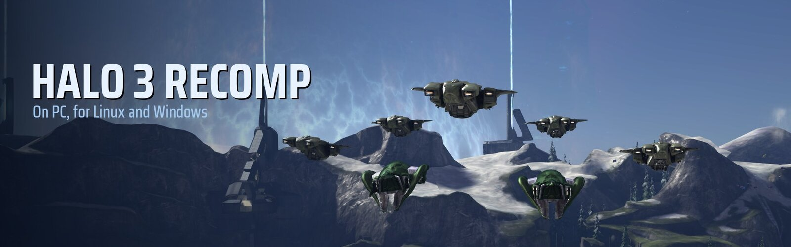
</p>

# Halo 3 Recomp

**Halo 3 for PC, on Linux and Windows,** made by statically recompiling the
Xbox 360 game's own code to C++. The game's PowerPC code is translated ahead
of time and runs directly on your CPU, but **this is not a native port
(yet)**: the systems around it (the 360's GPU, its XMA audio hardware and its
operating system) are emulated at a high level by the runtime, which builds
on what [Xenia](https://github.com/xenia-project/xenia) taught the world
about the console. Replacing the recompiled code with hand-written C++, a true native
port, is the project's long-term goal.

**No game data is included.** You need your own Halo 3 disc, dumped to a
disc image ([how](docs/DUMPING.md)). The installer builds the game from it on
your PC; nothing from Halo 3 is ever distributed.

Project site (FAQ, guides, how it works, roadmap, updates):
**https://george0815.github.io/halo-3-recomp/**

## Features

### The whole game

The campaign (solo and two-player co-op), multiplayer Custom Games, Forge and
Theater, all running on Halo 3's own engine and rules.

<table>
  <tr>
    <td>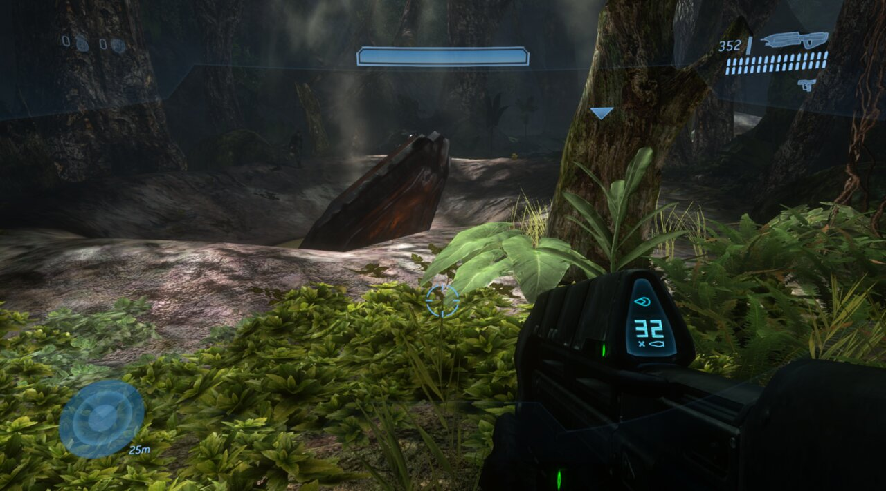</td>
    <td>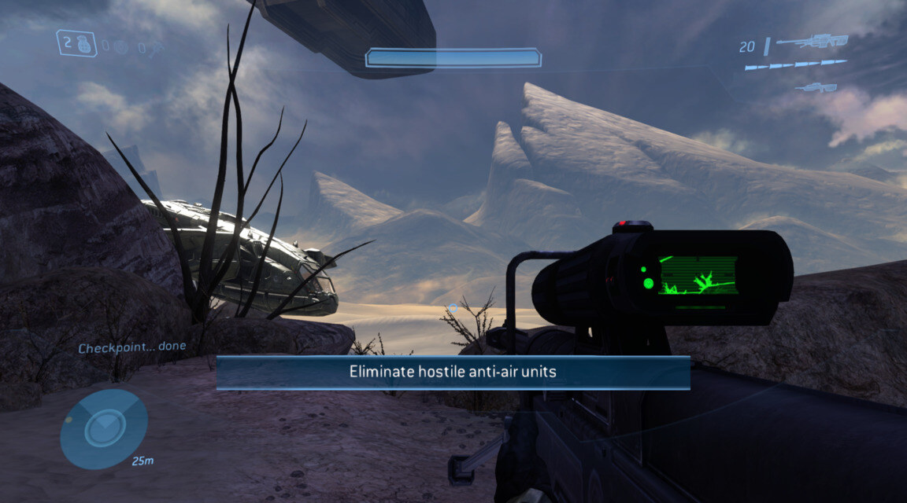</td>
    <td>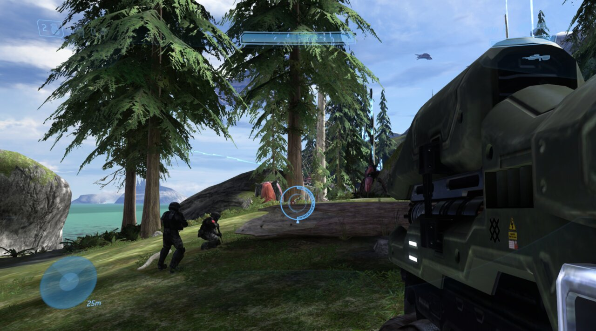</td>
  </tr>
  <tr>
    <td align="center">Sierra 117</td>
    <td align="center">The Ark</td>
    <td align="center">The Covenant</td>
  </tr>
</table>

### 60 frames per second

The game runs at 60 ticks a second, with fixes for what the 360 version tied
to 30 (weapon fire rates, physics, camera shake, AI, animations), checked
tick by tick against the original with recorded films.

### Higher resolutions

2x and 3x the 360's resolution, FXAA, any window size, fullscreen.

<p align="center">
  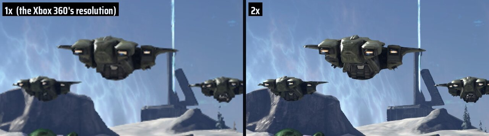
</p>

### Keyboard and mouse that feel native

Direct mouse look like MCC's, zoom-aware mouse speed, a mouse pointer in the
menus, toggle crouch, hold to zoom, and your own keys shown in the game's
prompts and menus.

<table>
  <tr>
    <td width="50%">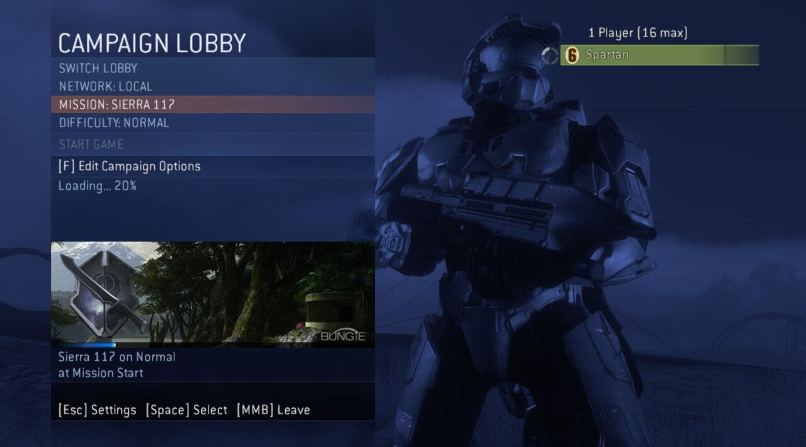</td>
    <td width="50%">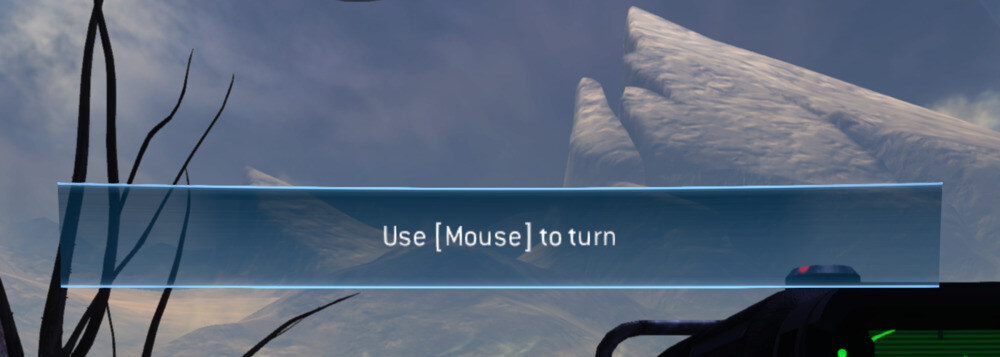</td>
  </tr>
</table>

### PC options

Field of view, centered crosshair, vehicle mouse sensitivity, skipping the
intro, the 360's original text and icons if you prefer them: all in the
launcher, along with the window, resolution and frame rate.

<p align="center">
  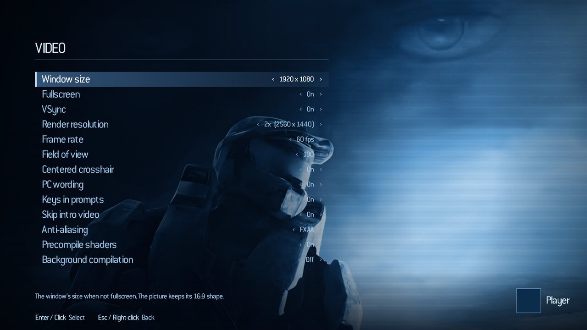
</p>

### Split screen

Up to four players on one PC, any mix of controllers and the keyboard.

<p align="center">
  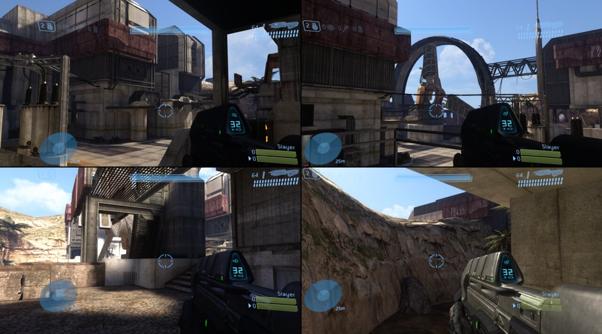
</p>

### System link

LAN games, and games with friends over the internet, Linux and Windows
together. No Xbox Live needed.

<p align="center">
  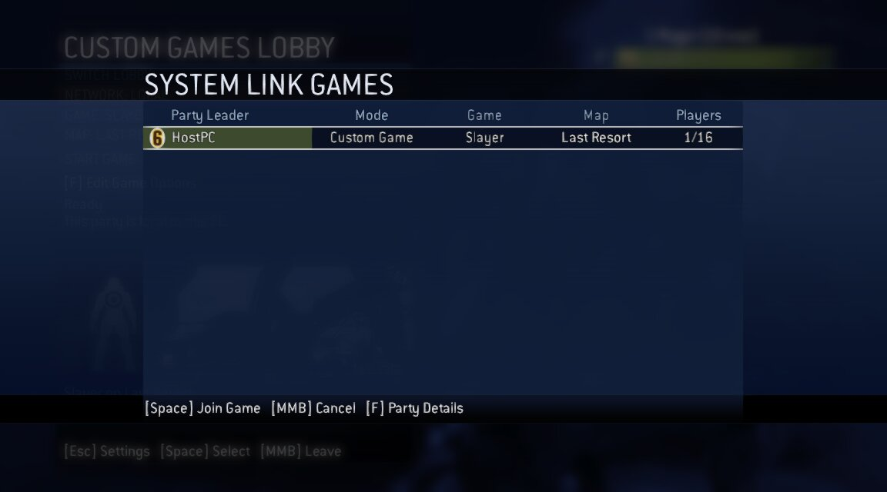
</p>

### Linux and Windows

One code base, one launcher, and the same game on both.

## Installing

1. Download the release for your system (Releases on this page) and unpack
   it into a folder of its own.
2. Start **H3Launcher**, select **INSTALL** and choose your Halo 3 disc image.
   It checks the disc, copies the game's files (about 6 GB), translates and
   compiles the game's code and prepares its shaders (a few minutes), and
   then it's ready: **LAUNCH**.

<p align="center">
  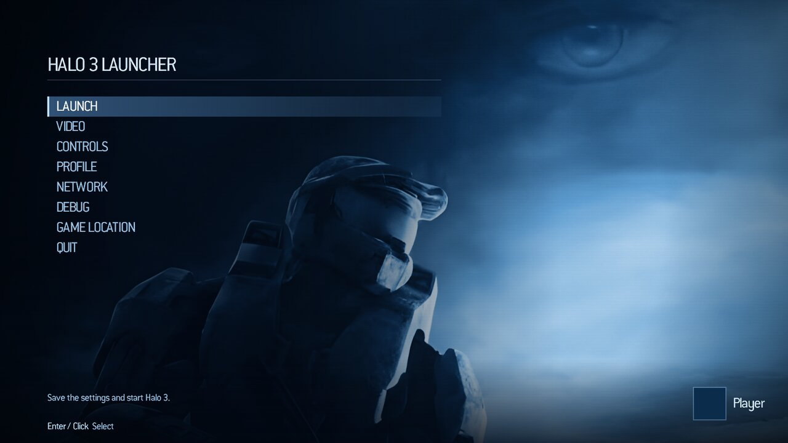
</p>

You need a 64-bit PC with a Vulkan graphics card and about 8 GB of disk
space. On Windows (10 version 1903 or later), the installer downloads
Microsoft's C runtime and Windows SDK once, after asking you to accept
Microsoft's terms. On Linux, install clang 18 or newer first
(`sudo apt install clang`, `sudo dnf install clang`, `sudo pacman -S clang`).

Only the original disc release of Halo 3 is supported for now (`default.xex`
SHA-1 `927a8c49062a55179d84116e33f8a5a0b3db13c1`); title updates and other
pressings aren't yet.

The [player guide](docs/guide.md) covers the launcher, the controls, split
screen and system link in detail; the [FAQ](docs/faq.md) answers the usual
questions.

## Default keys

| Key | Action |
|---|---|
| W A S D / Mouse | Move / look |
| Left / right mouse button | Fire / zoom |
| Space | Jump (A) |
| Left Shift | Grenade |
| Middle mouse, V | Melee |
| Mouse wheel, Q | Switch weapons |
| R | Reload / pick up |
| G | Switch grenades |
| F | Use equipment |
| C | Crouch |
| E, Left Ctrl | Fire |
| Escape / Tab | Start (menu) / Back (scoreboard) |
| In menus | The mouse points and clicks; right click goes back |

Every key can be changed in the launcher (CONTROLS). Controllers use the
standard Halo 3 layout.

<p align="center">
  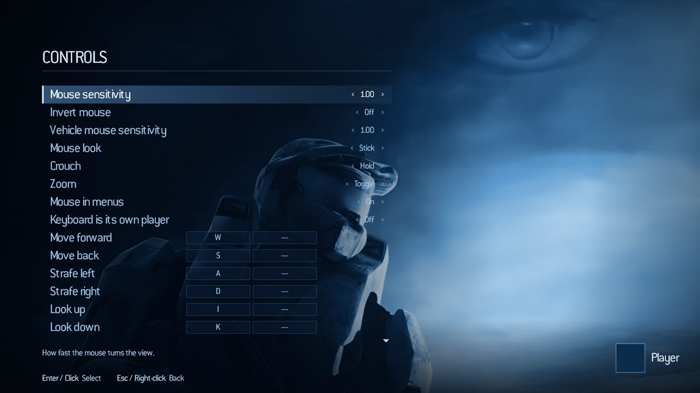
</p>

## Playing together

### Split screen (one PC)

Plug in more controllers and press **START** on each: that player joins and
is signed in with the name set in the launcher (PROFILE, "Player 2 gamertag"
and so on). Hold **BACK + START** for two seconds to leave. Campaign co-op
takes two players; multiplayer takes four.

### System link (LAN or internet)

**Everyone, once, in the launcher:** NETWORK > **System link: On**. Leave the
port at 41001 unless you need another one. Everyone needs the same release of
this project and the same **Frame rate** setting (VIDEO), or the games won't
see each other.

**On a LAN** (same network), that's all the setup there is.

**Over the internet**, the host forwards UDP port 41001 on their router to
their PC, and everyone else adds the host's public address under NETWORK >
**Friends** (`address` or `address:port`; several separated by commas).
Only the host needs a reachable port: the others reach each other through
the host. If the host can't forward a port, a VPN that puts everyone on one
network works as a fallback: list each other's VPN addresses in Friends
instead.

**Then, in the game:**

1. **Host:** main menu **CUSTOM GAMES** (or **FORGE**) > in the lobby,
   **NETWORK: LOCAL** > **SYSTEM LINK** > **HOST GAME**. Pick the game type
   and map, then wait for the others in the lobby.
2. **Everyone else:** **CUSTOM GAMES** (or **FORGE**) > **NETWORK: LOCAL** >
   **SYSTEM LINK** > **FIND GAME...**: the host's game shows up in the list
   (as in the System link picture above). Select it to join.
3. **Host:** **START GAME**.

If the game doesn't show up: check that system link is on and the frame
rate setting matches on every PC, that a firewall isn't blocking UDP port
41001, and (over the internet) that the addresses in Friends are right.
More in the [player guide](docs/guide.md#system-link).

## How it works

1. **[XenonRecomp](https://github.com/hedge-dev/XenonRecomp)** translates
   every PowerPC function in the game's `default.xex` (and the DLLs it loads)
   into C++.
2. **The runtime** (`H3Recomp/`) provides what the Xbox 360 did: guest memory,
   the kernel and XAM system calls, the Xenos GPU (translated to Vulkan), XMA
   audio, input, networking.
3. **Hooks** replace or adjust individual game functions: the 60 Hz fixes,
   mouse look, the menu cursor, PC text, system link.
4. **The ISO tool** (`h3setup`) runs step 1, and the build, on your own
   machine from your disc, so the release itself contains only our code.

Over time, recompiled functions get replaced with hand-written C++ (the
native port). The approach follows [Unleashed Recompiled](https://github.com/hedge-dev/UnleashedRecomp);
[Xenia](https://github.com/xenia-project/xenia) is the reference for the
360's kernel and GPU. More on the [architecture](docs/ARCHITECTURE.md) and
how the project [tests itself with recorded films](docs/testing.md).

## Building from source

```sh
git submodule update --init --recursive
cmake --preset release && cmake --build --preset release   # tools only
# With your default.xex in private/:
tools/build_ffmpeg.sh && tools/recompile.sh && cmake --build --preset release
build/release/H3Launcher/H3Launcher
```

You need CMake, Ninja, Clang 18+, SDL3, shaderc, a Vulkan driver and (for
the launcher) Qt 6. [Building](docs/building.md) has the details, the source
layout and how releases are packaged; [Debugging](docs/debugging.md) lists
the debugging switches.
Want to help? [Contributing](docs/contributing.md) walks through the
conventions and the common changes step by step.

## Status

Version 0.75: the campaign, multiplayer, Forge and Theater play through at
60 Hz on Linux and Windows. Next is the native port: replacing the
recompiled code with readable C++, subsystem by subsystem. See the
[roadmap](docs/ROADMAP.md).

## Credits

This project stands on other people's work:

- **[Xenia](https://github.com/xenia-project/xenia)**, the Xbox 360
  emulator. Its source is the reference for how the console behaves, and
  the runtime's emulation of the kernel, the Xenos GPU (command stream,
  shaders, EDRAM) and XMA audio follows it closely. The XMA decoder is
  Xenia's `xmaframes` FFmpeg decoder. Without Xenia's years of research,
  this project wouldn't exist.
- **[XenonRecomp](https://github.com/hedge-dev/XenonRecomp)** (hedge-dev),
  the static recompiler that turns the game's PowerPC code into C++, and
  **[Unleashed Recompiled](https://github.com/hedge-dev/UnleashedRecomp)**,
  which showed what a recompiled 360 game can become and is the model for
  this project's approach.
- **Halo: The Master Chief Collection** and the **Halo 3 Editing Kit**,
  studied for how the PC version handles 60 Hz, mouse look and the other PC
  options.
- **Bungie**, for Halo 3, and **343 Industries**.
- The libraries and tools in every build: [SDL](https://libsdl.org),
  [Qt](https://qt.io), [FFmpeg](https://ffmpeg.org),
  [shaderc](https://github.com/google/shaderc) (glslang, SPIRV-Tools),
  [LLVM](https://llvm.org) (the compiler the Windows release ships),
  [xwin](https://github.com/Jake-Shadle/xwin),
  [SIMDe](https://github.com/simd-everywhere/simde),
  [xxHash](https://github.com/Cyan4973/xxHash), [{fmt}](https://fmt.dev) and
  [toml++](https://marzer.github.io/tomlplusplus/).

## Legal

Halo 3 is a trademark of Microsoft. This project is not affiliated with or
endorsed by Microsoft, Bungie or 343 Industries. The download contains no
game code or data; use it only with a copy of the game you own.

The project is under the MIT license (LICENSE). Third-party code keeps its
own licenses (thirdparty/, and THIRD-PARTY.txt in releases).
